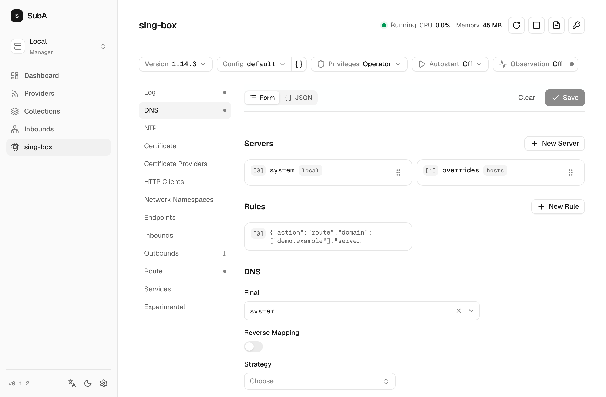

# SubA

[English](README.md)

SubA 是轻量的自托管代理订阅服务，可选管理 sing-box。

SubA 主要由 AI 编写，目前处于 Beta 阶段。

## 功能特性

- 代理订阅导入、筛选、转换与分发
- 基于 JSON Schema 驱动的完整 sing-box 配置
- 按用户独立控制入站访问权限
- 支持将订阅集合绑定至 sing-box 出站
- 通过代理程序（Agent）实现跨主机的 sing-box 集中化管理
- 单一 Rust 二进制文件，基于文件的存储，无数据库

## sing-box

要求 sing-box **1.14.0** 或更高版本。



## 快速开始

### 安装

#### Linux 二进制包

从 [GitHub Releases](https://github.com/zlpharepo/suba/releases) 下载对应架构的 Linux 归档。在 ARM64 上将 `amd64` 改为 `arm64`。

```sh
tar -xzf suba-linux-amd64.tar.gz
./suba --config ./config --data ./data
```

#### systemd

在使用 systemd 的 Linux 上，先停止前台运行的 SubA。首次安装时，创建服务用户和用户组。

```sh
sudo useradd --system --user-group --shell /bin/false suba
```

在解压后的二进制文件所在目录执行以下命令。

```sh
sudo install -m 0755 ./suba /usr/local/bin/suba
sudo install -d -m 0700 -o suba -g suba /etc/suba /var/lib/suba
```

将以下单元文件保存为 `/etc/systemd/system/suba.service`。

```ini
[Unit]
Description=SubA
After=network.target

[Service]
User=suba
Group=suba
ExecStart=/usr/local/bin/suba --host 127.0.0.1 --port 8090 --config /etc/suba --data /var/lib/suba
Restart=on-failure

[Install]
WantedBy=multi-user.target
```

设置开机自启并立即启动服务。

```sh
sudo systemctl daemon-reload
sudo systemctl enable --now suba.service
```

#### Docker CLI

以下 Docker 示例在 Linux 上使用 host 网络，sing-box 可直接监听宿主机端口。Web 界面监听在回环地址。TUN 需要额外的设备访问和权限。

```sh
docker run -d --name suba --restart unless-stopped --network host \
  -e SUBA_HOST=127.0.0.1 \
  -v suba-config:/app/config \
  -v suba-data:/app/data \
  ghcr.io/zlpharepo/suba:latest
```

#### Docker Compose

保存为 `compose.yaml`，然后运行 `docker compose up -d`。

```yaml
services:
  suba:
    image: ghcr.io/zlpharepo/suba:latest
    network_mode: host
    restart: unless-stopped
    environment:
      SUBA_HOST: 127.0.0.1
    volumes:
      - suba-config:/app/config
      - suba-data:/app/data

volumes:
  suba-config:
  suba-data:
```

### 首次使用

启动 SubA 后，在宿主机打开 `http://localhost:8090`，点击 **Install Web**，然后创建管理员账号。

- 在**订阅源**中添加来源，在**集合**中创建分发链接。
- 打开 **sing-box** 页面，安装内核、编辑原生配置并启动内核。

## 许可证

[GNU 通用公共许可证 v3.0](LICENSE)
